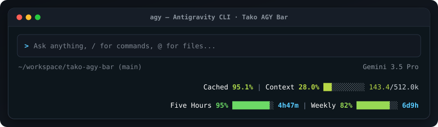

# Tako AGY Bar

<p align="center">
  <b>A minimal, two-line, right-aligned 24-bit TrueColor status bar for Google Antigravity CLI (<code>agy</code>)</b>
</p>

<p align="center">
  <a href="README.md">简体中文</a> | <a href="README.en.md">English</a>
</p>

<p align="center">
  = 18" />
  
  
  
</p>

---

## 📸 Preview

With `stack_with_default: true` enabled by default, the built-in status line stays on top while **Tako AGY Bar** aligns cleanly to the right below it:

<p align="center">
  
</p>

Plain-text layout:

```text
                                                  accept-edits · Gemini 4 Hydrogen · xhigh

                                      Cached 98.7% | Context 38.1% ███░░░░░░░ 399.2/512.0k

                                    Five Hours 63% ██████░░░░ 4h37m | Weekly 82% ████████░░ 6d9h
```

---

## 🤖 One-Click Auto-Install via Antigravity CLI (Recommended)

Copy and paste the prompt below directly into **Antigravity CLI (`agy`)** to automatically clone, install, verify, and configure everything across Windows, macOS, Linux, or WSL:

```text
Please install and enable Tako AGY Bar (https://github.com/TakotsuboChen/tako-agy-bar):

1. Check that git and node (>= 18) are available on this system (let me know first if either is missing).
2. Shallow-clone https://github.com/TakotsuboChen/tako-agy-bar.git (--depth 1) into a temporary OS directory (do not place it inside my current project workspace).
3. Inside that temporary directory, run:
   node install.mjs
   node test/statusline.test.mjs
4. Note: install.mjs runs syntax and smoke checks, atomically deploys the runtime files to ~/.gemini/antigravity-cli/hooks/, and safely merges the statusLine block (BOM-free, with stack_with_default: true) into ~/.gemini/antigravity-cli/settings.json and ~/.gemini/settings.json (if present) without altering any other existing settings.
5. Once all tests pass, clean up the temporary cloned directory.
6. Print the exact "/statusline ..." activation command returned by install.mjs so I can enable it immediately inside the running Antigravity CLI session without restarting.
```

> [!TIP]
> Prefer replacing the built-in status line instead of stacking below it? Pass `--no-stack` (`node install.mjs --no-stack`).

---

## ✨ Features

- **Minimal Two-Line Right-Aligned Layout (`stack_with_default: true`)**
  - **Line 1**: Real-time **Prompt Cache hit rate** + **Context usage** (`pct%` + borderless 10-cell bar + `used/ceiling`).
  - **Line 2**: **5-Hour short-term quota** + **7-Day weekly quota** (`remaining%` + borderless 10-cell bar + reset countdown).
  - Built-in spacer lines above Line 1 and between Line 1 & Line 2 prevent vertical bar sticking even in compact terminals (`lineHeight < 1.0`), without needing `padding` restarts.

- **Smooth 24-bit TrueColor RGB Gradients**
  - Interpolates continuously across Green (`#5cdb6d`) → Yellow (`#ffd427`) → Red (`#ff5555`):
    - **`Cached`**: Mapped over `[80%, 100%]` (`100%` green → `90%` yellow → `<=80%` red) to surface cache misses immediately.
    - **`Context`**: Percentage, filled bar blocks, and used token count all scale uniformly by remaining headroom against Antigravity CLI's **actual soft compaction limit** (rather than the model's raw physical window), keeping colors consistent across the entire Context segment.
    - **`Five Hours` / `Weekly`**: Scale by remaining quota `[0%, 100%]`, with reset countdowns highlighted in crisp blue (`#57caff`).

- **4-Tier Context Resolution & Session Isolation**
  - Calculates exact cache hit rates from `current_usage` (`cache_read / (input + cache_creation + cache_read)`) and persists per-conversation values to smooth out transient `null` payloads during streaming.
  - Resolves effective compaction ceilings across 4 tiers: native payload fields → settings/env overrides → live `GetCascadeTrajectoryGeneratorMetadata` RPC → `GetAvailableModels` catalog & `256k → 512k → 1M` stepped fallback.
  - Isolates empty or `'default'` placeholder conversation IDs so brand-new blank sessions never display stale context from previous runs.

- **Zero Dependencies & Cross-Platform Hardened**
  - Pure Node.js ESM (`.mjs`), zero `npm install`, zero background daemons or scheduled tasks.
  - Windows-safe command generation (omits double quotes to avoid Go `cmd /c` escaping issues, supports spaces via `--import file:///...`, strips UTF-8 BOM on every JSON write).
  - macOS / Linux / WSL NVM-safe absolute `process.execPath` resolution.

---

## 🛠️ Manual Install / Update / Uninstall

### Install

```bash
git clone --depth 1 https://github.com/TakotsuboChen/tako-agy-bar.git
cd tako-agy-bar
node install.mjs
```

### Update

```bash
git pull --ff-only
node install.mjs
```

### Uninstall

```bash
node uninstall.mjs
```

Restores your previously backed-up `statusLine` configuration (or reverts to the built-in status line) and removes only the files deployed by Tako AGY Bar.

---

## 🙏 Acknowledgements

The Language Server RPC quota collector, 4-tier context ceiling resolver, and BOM-safe JSON utilities under `hooks/fetch-local-quota.mjs` and `hooks/lib/` are adapted from [AndyAWD/antigravity-cli-statusline](https://github.com/AndyAWD/antigravity-cli-statusline) (MIT License), streamlined to zero external dependencies with Tako AGY Bar's compact two-line TrueColor renderer, Prompt Cache hit-rate telemetry, session isolation fixes, and native `stack_with_default` integration.

## 📄 License

Released under the [MIT License](LICENSE).
