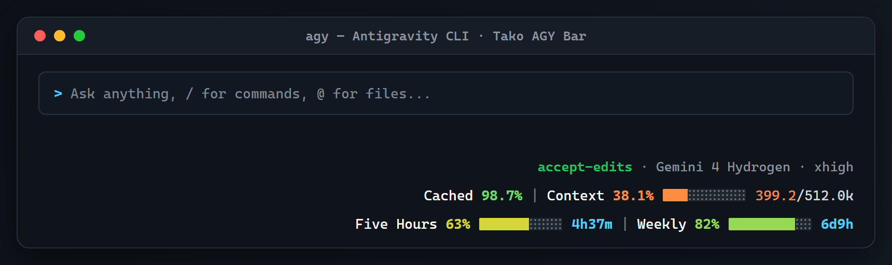

# Tako AGY Bar

<p align="center">
  <b>专为 Google Antigravity CLI (<code>agy</code>) 打造的极简双行、右对齐、24-bit TrueColor 连续渐变状态栏</b>
</p>

<p align="center">
  <a href="README.md">简体中文</a> | <a href="README.en.md">English</a>
</p>

<p align="center">
  = 18" />
  
  
  
</p>

---

## 📸 效果预览

默认开启 `stack_with_default: true`，上方保留官方原生状态栏（工作区路径、Git 分支、当前模型），下方自动靠右渲染 **Tako AGY Bar** 双行遥测：

<p align="center">
  
</p>

---

## 🤖 一键让 Antigravity CLI 自动安装（推荐）

打开你的 **Antigravity CLI (`agy`)**，**直接复制粘贴下面整段 Prompt 发送即可自动完成安装、测试与配置**（支持 Windows / macOS / Linux / WSL）：

```text
请帮我安装并启用 Tako AGY Bar（https://github.com/TakotsuboChen/tako-agy-bar）：

1. 先检查当前系统的 git 和 node 版本（要求 Node.js >= 18；若缺少或版本过低请先提示我处理）。
2. 把 https://github.com/TakotsuboChen/tako-agy-bar.git 浅克隆（--depth 1）到系统临时目录（不要放到我当前的工作区目录里）。
3. 进入该临时目录，依次执行：
   node install.mjs
   node test/statusline.test.mjs
4. 说明：install.mjs 会先完成语法与冒烟测试，再原子部署脚本到 ~/.gemini/antigravity-cli/hooks/，并无 BOM 安全合并写入 ~/.gemini/antigravity-cli/settings.json（及已存在的 ~/.gemini/settings.json）中的 statusLine 配置（默认 stack_with_default: true 与原生状态栏上下叠放）。不要删改 settings.json 中除 statusLine 以外的任何已有配置。
5. 全部验证通过后，清理刚刚的临时克隆目录。
6. 最后把 install.mjs 输出的「/statusline ...」立即生效指令完整展示给我，让我不用重启就能在当前 Antigravity CLI 中启用。
```

> [!TIP]
> 如果你希望**完全替换**官方原生状态栏（不在上方保留原装那一行），只需要让安装脚本带上 `--no-stack` 参数即可（`node install.mjs --no-stack`）。

---

## ✨ 核心特性

- **🎯 极简双行 · 原生上下叠放**
  - 第 1 行实时展示 **Prompt Cache 命中率** 与 **Context 窗口占用**（百分比 + 无边框 10 格进度条 + `已用/有效上限`）。
  - 第 2 行实时展示 **5 小时短周期配额** 与 **7 天周配额**（剩余百分比 + 无边框 10 格进度条 + 刷新倒计时）。
  - 通过原生 `stack_with_default: true` 与官方状态栏上下共存；并在输出首行与两行之间内建空行隔离，即使在 `lineHeight < 1.0` 的高紧凑终端下也绝不像素粘连，且支持热重载免重启生效。

- **🌈 24-bit TrueColor 三段线性连续渐变**
  - 锚定翠绿 `#5cdb6d` → 琥珀黄 `#ffd427` → 珊瑚红 `#ff5555` 平滑插值，告别生硬的四档阶梯跳变：
    - **Cached 命中率**：按 `[80%, 100%]` 敏感区间映射（`100%` 绿 → `90%` 黄 → `≤80%` 红），一眼看穿长上下文缓存是否失效。
    - **Context 用量**：百分比数字、进度条填充与已用 Token 分子**统一按 Antigravity CLI 实际软限制（Compaction 上限）剩余比例**渐变着色（而非模型物理窗口），低占用绿 → 半载黄 → 临近软压缩上限红，颜色完全一致且分母保持亮白清晰可读。
    - **Five Hours / Weekly 配额**：按剩余额度 `[0%, 100%]` 渐变，刷新倒计时保留高亮冰蓝 `#57caff`。

- **🧠 四层上下文解析 & 缓存防抖防串库**
  - 精准依据 `cache_read_input_tokens / (input_tokens + cache_creation_input_tokens + cache_read_input_tokens)` 计算缓存命中率，并在流式瞬态上报 `current_usage: null` 时自动沿用当前会话持久化的最新命中率，防止数值闪烁归零。
  - 四层解析有效上下文上限：原生限额字段 → 设置 / 环境变量覆写 → 运行时 `GetCascadeTrajectoryGeneratorMetadata` → 模型目录 `GetAvailableModels` / `256k → 512k → 1M` 步进自愈。
  - 严格屏蔽空 `conversation_id` 与 `default` 占位键写入本地缓存，新建空白对话绝不会串库显示旧会话上下文。

- **⚡ 零外部依赖 · 零常驻进程 · 跨平台防坑**
  - 纯 Node.js ESM (`.mjs`) 编写，**0 `npm` 依赖**、**0 常驻后台进程 / 定时任务**，仅在 `agy` 刷新状态栏时毫秒级按需执行。
  - Windows 下自动检测路径空格并生成无双引号命令（规避 Go `cmd /c` 双引号转义破坏），所有配置文件采用临时文件原子写入并校验剥除 UTF-8 BOM。
  - macOS / Linux / WSL 下自动写入 `node` 绝对路径，完美兼容 `nvm` 等多版本管理器在非交互子 Shell 中的 `PATH` 缺失问题。

---

## 🛠️ 手动安装 / 更新 / 卸载

### 手动安装（三行命令）

```bash
git clone --depth 1 https://github.com/TakotsuboChen/tako-agy-bar.git
cd tako-agy-bar
node install.mjs
```

安装完成后，直接在运行中的 `agy` 输入框执行脚本最后输出的 `/statusline ...` 指令（或重启一次 `agy`）即可生效。

### 更新到最新版

```bash
git pull --ff-only
node install.mjs
```

### 一键无损卸载

```bash
node uninstall.mjs
```

`uninstall.mjs` 仅移除 Tako AGY Bar 部署到 `~/.gemini/antigravity-cli/hooks/` 的文件；若安装前备份过原有的 `statusLine` 配置会自动还原，否则恢复为官方内置状态栏，**绝不删改你的其他任何 CLI 配置**。

---

## ⚙️ 进阶配置选项

| 配置方式 | 位置 / 参数 | 说明 |
| :--- | :--- | :--- |
| **关闭上下叠放** | `node install.mjs --no-stack` | 将 `statusLine.stack_with_default` 设为 `false`，仅显示双行 Tako AGY Bar |
| **进度条长度** | `settings.json` 中 `ui.barLength` | 默认 `10` 格，可自定义为 `8`、`12` 等整数（范围 `1~50`） |
| **自定义上下文上限** | 环境变量 `AGY_TOKEN_CEILING` | 支持 `256k`、`512k`、`1m`、`full` 或具体数值 |
| **临时禁用状态栏** | 环境变量 `DISABLE_QUOTA_HOOK=1` | 跳过状态栏输出并直接静默退出 0（可用于排障或临时隐藏） |
| **自定义安装家目录** | `node install.mjs --home <dir>` | 指定部署目标主目录，支持 `--dry-run` 预演变更 |

---

## 📁 仓库结构

```text
tako-agy-bar/
├── install.mjs                        # 跨平台零依赖安装器（含语法检查与冒烟校验）
├── uninstall.mjs                      # 无损卸载与配置还原脚本
├── package.json
├── assets/
│   └── tako-agy-bar-preview.png       # 终端效果预览图
├── hooks/
│   ├── custom-compact-statusline.mjs  # 双行右对齐 TrueColor 状态栏主入口
│   ├── fetch-local-quota.mjs          # Language Server RPC 本地配额拉取器
│   └── lib/
│       ├── collectors/                # 账号元信息 / 四层上下文 / LS RPC / 配额池 / 倒计时
│       ├── core/                      # 常量 / 无 BOM 原子文件读写 / 标准化 / 配置解析
│       └── renderers/                 # ANSI 颜色与宽字符显示宽度计算
└── test/
    └── statusline.test.mjs            # Node 内置测试套件（node --test）
```

---

## 🙏 致谢

`hooks/fetch-local-quota.mjs` 及 `hooks/lib/` 下的 Language Server RPC 配额拉取、四层上下文上限解析与跨平台配置工具模块，基于 MIT 协议改造精简自开源项目 [AndyAWD/antigravity-cli-statusline](https://github.com/AndyAWD/antigravity-cli-statusline)。在此基础上剥离了插件守护进程、MCP 服务与冗余配置流，重制为极简零依赖的双行右对齐渐变状态栏，并补充了 Prompt Cache 命中率实时遥测、平滑连续 RGB 渐变、空对话缓存串库防护与原生 `stack_with_default` 布局适配。

## 📄 开源协议

基于 [MIT License](LICENSE) 开源。
